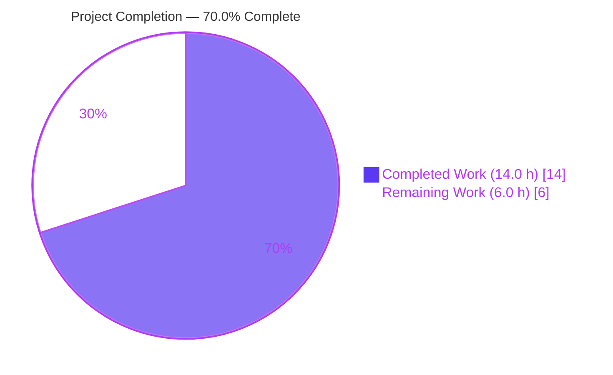
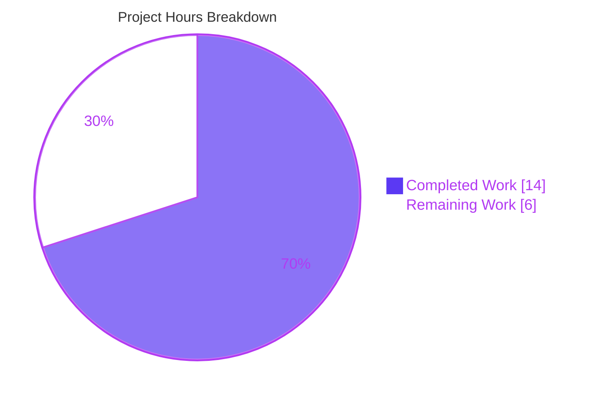
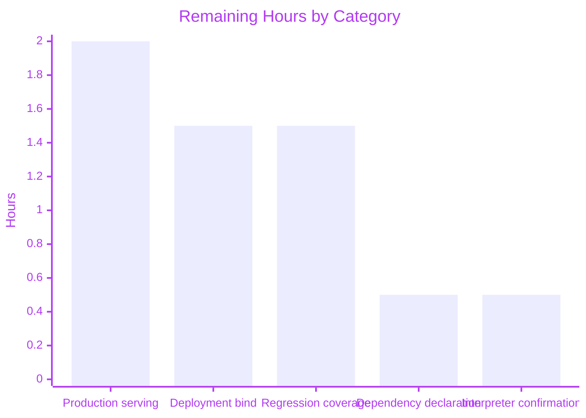

# 1. Executive Summary

## 1.1 Project Overview

This project replaced a one-line Node.js HTTP server with an equivalent Python 3 Flask application in one new file, `app.py`, at the repository root. It serves every HTTP client of the previous server: any request path and all nine standard methods receive the fixed 14-byte body `Hello, World!\n` at status 200, the process binds port 3000, and it prints `Server running at http://127.0.0.1:3000/` exactly once at start-up. The port is deliberately minimal — 16 lines, no comments, no configuration — and the repository's pre-existing Java/Maven Selenium-Cucumber suite is untouched.

## 1.2 Completion Status

**70.0% complete** — 14.0 of 20.0 total hours delivered, 6.0 hours of production work remaining.



| Metric | Hours |
|---|---|
| Total Hours | 20.0 |
| Completed Hours (AI + Manual) | 14.0 |
| Remaining Hours | 6.0 |

Completion = Completed Hours ÷ Total Hours = 14.0 ÷ 20.0 = **70.0%**. The denominator covers the port's 28 scoped requirements plus the five items of production work needed to run it beyond this host.

## 1.3 Key Accomplishments

- [x] The fixed 14-byte body `Hello, World!\n` on every request path, byte-exact on the wire and in a browser.
- [x] Status 200 on every registered path and method.
- [x] All nine standard methods on both rules; HEAD returns no body with `Content-Length: 14`.
- [x] The catch-all reaches root, nested, trailing-slash, duplicate-slash, unicode, encoded and 20,000-character targets.
- [x] The framework's static route is suppressed, so `/static/…` returns the fixed body rather than a 404.
- [x] One listener on 127.0.0.1:3000, released cleanly when the process stops.
- [x] The startup line printed exactly once, still one occurrence after hundreds of requests.
- [x] The pre-existing Java project still compiles unchanged: 25 sources at javac target 8.

## 1.4 Critical Unresolved Issues

5 of 32 scoped items remain open: four are production-readiness items the request excluded, and one is the dependency inventory's interpreter row. Two block a production release as delivered.

| Issue | Impact | Owner | ETA |
|---|---|---|---|
| The endpoint binds 127.0.0.1 only (`app.py:16`), where the server it replaces bound every interface | Nothing off-host can reach the service; a container or remote client receives no response. **Blocks release** | Deployment engineer | 1.5 h |
| Werkzeug's development server serves the traffic and answers one request per connection | Not suitable for production traffic; no connection reuse or request limits. **Blocks release** | Deployment engineer | 2.0 h |
| No dependency manifest or lock file declares Flask 3.1.3 / Werkzeug 3.1.9 | The target host's Flask provision is undeclared and unpinned | Build/Platform owner | 0.5 h |
| No automated test exists for the HTTP contract | Any future edit to `app.py` is unverified until the manual checks are repeated | Repository owner | 1.5 h |
| The dependency inventory names Python 3.12.3, which does not exist here | The interpreter the deployment should target is unconfirmed, though the file runs unmodified on 3.13.18 and 3.14.4 | Repository owner | 0.5 h |

## 1.5 Access Issues

No access issue affected this work: the endpoint needs no credentials, no external service and no repository permission beyond read access.

| System/Resource | Type of Access | Issue Description | Resolution Status | Owner |
|---|---|---|---|---|
| Upgenix/Odoo application and its test credentials (needed by the repository's pre-existing Cucumber scenarios) | Application login and a `configuration.properties` file | The scenarios cannot execute without both; no `configuration.properties` was ever committed and the external application is unreachable from this environment | Open — outside this port's scope; the endpoint needs neither | Repository owner |
| Inbound network access to port 3000 from outside the host | Host/container network exposure | Not available: the delivered server is loopback-only, so an off-host client cannot be validated against it as it stands | Open — the deployment bind work (1.5 h) closes it | Deployment engineer |

## 1.6 Recommended Next Steps

1. [High] Apply the deployment bind for port 3000 — loopback-only as delivered, so off-host clients are refused (1.5 h).
2. [High] Serve the application object under a production WSGI server and re-verify the four behaviours through it (2.0 h).
3. [Medium] Add a pytest suite over the contract: body bytes, status, the nine methods, the path families and the exactly-once startup line (1.5 h).
4. [Medium] Pin Flask 3.1.3 and Werkzeug 3.1.9 for the deployment environment (0.5 h).
5. [Low] Confirm the deployment interpreter and repeat the four behaviour checks under it (0.5 h).

# 2. Project Hours Breakdown

## 2.1 Completed Work Detail

Each row traces to a specific requirement of the port, and the rows sum to the 14.0 completed hours in Section 1.2.

| Component | Hours | Description |
|---|---|---|
| Documented-behaviour basis for the four acceptance behaviours | 3.0 | Establishing, at the pinned library versions (Flask 3.1.3 / Werkzeug 3.1.9), the documented mechanism behind each fixed behaviour: a returned string becoming a response with status 200, the `path` converter accepting slashes, the root rule supplied through `defaults`, the static route existing only when a static folder is set, and the reloader being off unless debug mode is enabled. |
| The `app.py` deliverable | 3.0 | The application object with its static route suppressed, the two route rules stacked on one view function, the single-line accepted-method list, the fixed body constant, the module-level startup print and the server call — 16 lines, no comments, no abstraction and no entry-point guard (`app.py:1-16`). |
| All-path coverage verification | 3.0 | Exercising the root, nested, trailing-slash, duplicate-slash, dot-segment, unicode, percent-encoded, 20,000-character and 199-segment targets, and the `/static/…` prefix, confirming the fixed body and status 200 with no redirect anywhere. |
| Nine-standard-method coverage verification | 2.0 | Exercising GET, HEAD, POST, PUT, DELETE, CONNECT, OPTIONS, TRACE and PATCH on both rules, confirming status 200 for each, the zero-length HEAD body with `Content-Length: 14`, and the framework's 405 for a verb outside the nine. |
| Body, status, port and startup-line confirmation | 2.0 | Byte comparison of the response body on the wire, the status-code probe, the single-listener check on 127.0.0.1:3000, the count of the startup line in captured process output, and the same rendering checks driven in a real browser. |
| Constraint and change-set compliance | 1.0 | Confirming the single-file footprint, the absence of tests, documentation, configuration, manifests and added handling, that the pre-existing Java/Maven tree is byte-identical, and that nothing in the repository references or consumes the new file. |
| **Total** | **14.0** | |

## 2.2 Remaining Work Detail

Every category below traces to a path-to-production need or to the one partially completed requirement of the port; the rows sum to the 6.0 remaining hours in Section 1.2 and to the remaining-hours value in Section 7.

| Category | Hours | Priority |
|---|---|---|
| Production WSGI serving — replace the framework's development server with a production WSGI server and re-verify the four behaviours through it | 2.0 | High |
| Deployment network exposure — decide and apply the bind for port 3000, which is loopback-only as delivered, so the endpoint is reachable off-host | 1.5 | High |
| Automated regression coverage — a pytest suite over the HTTP contract: body bytes, status 200, the nine methods, the path families and the exactly-once startup line | 1.5 | Medium |
| Runtime dependency declaration — pin Flask 3.1.3 and Werkzeug 3.1.9 for the target host, which no manifest currently records | 0.5 | Medium |
| Target-host interpreter confirmation — the open half of the dependency inventory, whose named interpreter is absent here | 0.5 | Low |
| **Total** | **6.0** | |

Completed 14.0 h + Remaining 6.0 h = Total Project Hours 20.0 h; Completion = 14.0 ÷ 20.0 = 70.0%.

# 3. Test Results

No automated test suite ships with this work — the request fixes a single-file deliverable carrying no test artefacts — so the endpoint's contract was verified by running it and probing it from outside. Every count below is a check executed against the delivered file at commit `a224161`, on Python 3.13.18 with Flask 3.1.3 and Werkzeug 3.1.9; no coverage instrumentation is configured in this project, so the coverage column records the surface each category exercised rather than a measured line percentage.

| Area / Category | Framework | Tests | Passed | Failed | Coverage | What This Proves |
|---|---|---|---|---|---|---|
| Response contract — body bytes, status and redirect count across 15 request paths (`/`, `/foo`, `/foo/`, `/a/b/c`, `/static/missing.js`, `/static/`, `/a//b`, `//`, `///`, `/./`, `/../`, `/dot.`, `/x.txt`, `/foo?x=1&y=2`, `/a/b/c/d/e`) | curl + Python byte comparison | 15 | 15 | 0 | Every path family the port claims; no instrumentation configured | A client receives the byte-exact 14-byte body `Hello, World!\n` with status 200 at every request path, and no probe is redirected. |
| Method coverage — the nine registered verbs on a non-root path | curl | 9 | 9 | 0 | All nine registered methods on both rules; no instrumentation configured | Every standard method is accepted with status 200, and HEAD returns no body while declaring `Content-Length: 14`. |
| Path-coverage boundary — four raw unnormalised targets plus a 20,000-character path, a 199-segment path and a percent-encoded unicode path | curl (`--path-as-is`) + Python byte comparison | 7 | 7 | 0 | The extremes of the catch-all rule; no instrumentation configured | Targets that a normalising client would not produce still reach the view and return the fixed body with no redirect. |
| Service lifecycle — binding, address, teardown and the exactly-once startup line | `/proc/net/tcp`, curl, socket bind, `grep` | 7 | 7 | 0 | Two complete start/stop cycles over a 132-line process log | Exactly one listener exists on 127.0.0.1:3000 while the service runs, port 5000 stays unused, the required line appears once as the log's first line, and shutdown releases the port for immediate reuse. |
| Concurrency and repeat stability | 60 parallel curl requests | 60 | 60 | 0 | Parallel traffic against the single view function | Every concurrent request returns status 200 with the fixed body, and neither the responses nor the startup-line count change under load. |
| Framework-boundary responses for targets and verbs outside the contract | raw socket + curl | 3 | 3 | 0 | The three boundary inputs the contract does not cover | An unregistered verb gets the framework's 405, a decoded line feed in the target gets the framework's 404, and an absolute-form target with no path gets a 308 — each the accepted framework default, never a 200. |
| Browser runtime — rendering, redirects, network and console | real headless Chrome | 14 | 14 | 0 | Five navigations, two page-context fetches and every network request the session issued | The endpoint renders as a plain three-element document reading `Hello, World!`, follows no redirect, fires no dialog, injects no payload and logs no console error. |
| Pre-existing Java/Maven build and its own end-to-end suite | Maven 3.9.12 / JDK 1.8.0_512, JUnit 4 | 6 | 2 | 4 | Compile only — surefire executes zero tests because the suite lives under `src/main` | The repository's 25 sources still compile to javac target 8, while its four Cucumber scenarios cannot run in this environment: they need a `configuration.properties` that was never committed and the external application. |
| **Total** | | **121** | **117** | **4** | | 117 checks confirm the delivered endpoint's contract; the 4 failures are the pre-existing Java scenarios, which cover nothing of this port. |

**Not Covered**

- **No automated regression guard.** The contract has no test in the repository, so nothing detects a future change to `app.py`; the checks above must be repeated by hand until the pytest suite in Section 2.2 exists.
- **The repository's own end-to-end suite does not execute.** Its four Cucumber scenarios need a `configuration.properties` (keys `browser`, `url`, `username`, `password`, `web.table.url`, `EmplTitle`) and the external Upgenix/Odoo application. A human must supply both before relying on that suite.
- **Never exercised at runtime:** serving under a production WSGI server, an off-host bind, HTTPS/TLS termination, IPv6, and sustained or long-duration load — the longest run held the process for about four minutes and served a few thousand requests.
- **No dependency or static-analysis scanning.** No vulnerability scanner or auditor is installed in this environment, so the dependency posture rests on the pinned, current versions of Flask and Werkzeug alone.
- **The framework's debug mode was not exercised in the delivered configuration.** Enabling it through the environment is a deployment constraint recorded in Section 6, not a behaviour of the delivered file.

# 4. Runtime Validation & UI Verification

The endpoint was driven end to end on the host as well as in a real browser; each line below is a flow or integration that was actually exercised.

- ✅ **Start-up** — `python3 app.py` from the repository root boots in about two seconds, prints `Server running at http://127.0.0.1:3000/` as the first line of its output, binds a single listener on 127.0.0.1:3000, and leaves port 5000 unused.
- ✅ **Root path** — `/` returns status 200 with the 14-byte body, rendered in Chrome as plain text on a blank page.
- ✅ **Nested and trailing-slash paths** — `/a/b/c` and `/foo/` return the byte-exact body with no redirect and the address bar unchanged.
- ✅ **Static-prefixed target** — `/static/missing.js` returns the fixed body at status 200; the framework's static route is absent, so no "Not Found" page appears.
- ✅ **All nine standard methods** — GET, HEAD, POST, PUT, DELETE, CONNECT, OPTIONS, TRACE and PATCH each return 200; HEAD returns no body with `Content-Length: 14`.
- ⚠ **Unregistered verb** — PROPFIND receives the framework's 405 page rather than the fixed body, which is what limiting the accepted methods to the nine standard verbs implies.
- ✅ **Unnormalised targets** — `//`, `//foo`, `///foo` and `/foo//bar` return the fixed body at 200 with no redirect, as do a 20,000-character path, a 199-segment path and unicode/encoded paths.
- ⚠ **Boundary targets** — a decoded line feed inside the target takes the framework's 404 page, and an absolute-form target with no path takes a 308 redirect; both are framework-level handling outside the contract.
- ✅ **Concurrency and shutdown** — 60 parallel requests all returned 200 with the fixed body, the startup line stayed at one occurrence, and stopping the process by its own pid released port 3000 for immediate reuse.
- ✅ **Browser session** — 14 of 14 network requests returned 200 (including the browser's own favicon probes, answered by the catch-all), with zero JavaScript console errors, no dialog and no injected element from an XSS-shaped path.

**Never exercised at runtime:** production WSGI serving, an off-host or TLS-terminated deployment, IPv6, sustained or long-duration load, and the repository's Java end-to-end scenarios, which cannot run without a `configuration.properties` and the external application. There are no other integrations to exercise: the endpoint reads no data store, calls no external service and reads no caller-supplied value.

**Interface verification.** Nothing is rendered from data and no interface exists to verify beyond transport: the browser shows a three-element document (one text node), with no stylesheet, no script, no title and no styling, which is exactly the contract the endpoint carries over. Screenshots of the root, nested, trailing-slash, static-prefix and XSS-shaped paths confirm the same plain text at every address.

# 5. Compliance & Quality Review

## 5.1 Compliance Matrix

Each row is a deliverable of this port and its verified state now.

| # | Deliverable / Requirement | Status | Evidence | Progress |
|---|---|---|---|---|
| 1 | Fixed 14-byte body `Hello, World!\n`, trailing newline included, on any request path | ✅ PASS | `app.py:6,12`; 15 path probes and 6 browser page loads byte-exact | ██████████ 100% |
| 2 | Status 200 on every registered path and method | ✅ PASS | 15 path probes, the nine-method loop, 123 × 200 in one run's process log | ██████████ 100% |
| 3 | Bound to port 3000 and serving | ✅ PASS | One `LISTEN` entry for 127.0.0.1:3000; port 5000 refused; port released on shutdown | ██████████ 100% |
| 4 | Startup line `Server running at http://127.0.0.1:3000/` printed exactly once | ✅ PASS | `grep -c` = 1 in a 132-line log, and the line is the log's first entry | ██████████ 100% |
| 5 | All-path coverage with the framework's static route suppressed | ✅ PASS | 15-path matrix, `/static/…` prefix, unnormalised, long, encoded and unicode targets; no redirect | ██████████ 100% |
| 6 | Nine-standard-method coverage, HEAD handled per the HTTP RFC | ✅ PASS | Nine verbs at 200 (`app.py:5,9,10`); HEAD zero-length with `Content-Length: 14` | ██████████ 100% |
| 7 | Single-file structure: one import, two rules on one view, no comments, no entry-point guard | ✅ PASS | `app.py:1-16`, byte-identical to the fixed content plan; zero comment tokens | ██████████ 100% |
| 8 | No added handling, configuration or hardening | ✅ PASS | No error or 404 handler, no configuration read, no logging, no retry; only the framework's five response headers | ██████████ 100% |
| 9 | No test, documentation, manifest, lock, deployment or CI artefact added; existing files untouched | ✅ PASS | Change set is `app.py` alone (16 insertions); no manifest exists anywhere; per-path diffs on the pre-existing tree empty | ██████████ 100% |
| 10 | Dependency versions used as specified, with nothing installed or upgraded | ✅ PASS | Flask 3.1.3 and Werkzeug 3.1.9 resolve on the runtime; no package was installed | ██████████ 100% |
| 11 | Dependency inventory's interpreter row (a named Python 3.12.3 runtime) | ⚠ PARTIAL | The named interpreter does not exist on this host; the file pins none and runs unmodified on Python 3.13.18 and 3.14.4 | █████░░░░░ 50% |
| 12 | Pre-existing Java/Maven project untouched and unmodified, with no consumer of the new file | ✅ PASS | 25 sources still compile at javac target 8; nothing in the tree imports or references `app.py` | ██████████ 100% |

## 5.2 AAP & Rule Divergences and Gaps

Eight departures from the agreed scope were established. The first is an environment limitation, the next six were sanctioned by the request or the plan and are recorded because they change how the service behaves or is deployed, and the last is a platform process requirement. No user rule governs this work, so no rule departure arises.

| What the AAP/Rule Required | What Was Delivered Instead | Why It Diverged | Impact | Remediation |
|---|---|---|---|---|
| The dependency inventory names Python 3.12.3 at `/usr/bin/python3` | The file is unchanged and pins no interpreter; it was validated under Python 3.13.18 (`python3`) and 3.14.4 (`/usr/bin/python3`), both carrying Flask 3.1.3 / Werkzeug 3.1.9 (`app.py:1-16`) | The named interpreter does not exist on this host, and a version pin would require the manifest the request forbids — an environment limitation, not a code choice | Low: the file uses nothing version-specific and behaves identically on both interpreters, but the runtime the deployment should target is left unconfirmed | Confirm and record the deployment interpreter, then repeat the four behaviour checks under it (0.5 h) |
| The replaced server bound every interface (`.listen(3000)`); the plan records the host binding as a decision and accepts framework defaults — **sanctioned** | `app.run(port=3000)` leaves the framework's default host, so the listener is 127.0.0.1 only (`app.py:16`) | The request names only the port as a criterion, and the plan's recorded host-binding decision keeps the framework default rather than reproducing the source's all-interface bind | High for deployment: nothing off-host can reach the endpoint, so a container or remote client receives no response. **Blocks a production release as delivered** | Decide the deployment bind and apply it at the serving layer (1.5 h) |
| The replaced server logged its startup line from the successful-listen callback | The line is printed at module level immediately before the server call (`app.py:15` then `:16`), so it is emitted once per process even if the bind then fails | Prescribed by the ported file's fixed content: a module-level print is what makes the line appear exactly once, and a callback would add a layer this port deliberately excludes | Medium: the count requirement holds, but a readiness check keyed on the line is misled when port 3000 is already occupied — the process prints the line and then exits 1 with the framework's diagnostic | No code change; gate readiness on the listener or the process exit status (folded into the serving task) |
| Carry over the four named behaviours and let every other protocol- or process-level behaviour fall to the framework's defaults — **sanctioned** | The framework's own output and protocol behaviour stand: its banner and one access line per request, five response headers including `Server: Werkzeug/3.1.9 Python/3.13.18`, one connection per response with no keep-alive or pipelining, 405 for verbs outside the nine, framework 400/404/431/505 pages, a 308 for an absolute-form target with no path, and a 404 for a decoded line feed in the target | The request fixes exact behaviour for four things and forbids adding handling the source server lacked, so suppressing or normalising the framework's output was out of scope | Low to Medium: a strict header or protocol comparison against the replaced server would notice, unusual verbs receive 405 instead of the body, and log consumers see framework lines around the required one | None required; if a clean log or header set is needed later, terminate the endpoint behind a proxy that normalises both |
| No dependency manifest or lock file — **sanctioned exclusion** | The dependency is declared only by the single import (`app.py:1`); nothing records Flask's version | An explicit exclusion of the request, carried into the plan's dependency statement | Medium: the host must already provide Flask and Werkzeug at the verified versions, and no reproducible install exists for a new environment | Pin and declare the two versions for the deployment environment (0.5 h) |
| No test artefacts of any kind — **sanctioned exclusion** | The contract was verified by running the service and probing it from outside; the repository holds no test for it | An explicit exclusion of the request | Medium: a future edit to `app.py` is unguarded until the manual checks are repeated | Add a pytest suite over the contract (1.5 h) |
| No hardening beyond the source server's behaviour and no added handling — **sanctioned** | The endpoint is served by the framework's development server, which warns against production use and answers one request per connection | The plan leaves process-level behaviour to the framework's defaults; introducing a WSGI server is a deployment decision, not a porting one | High for production: no connection reuse, no request-rate or body-size limits beyond the framework's own. **Blocks a production release** | Serve the application object under a production WSGI server and re-verify the four behaviours (2.0 h) |
| One file, source untouched, no repository process change | One commit was made containing `app.py` alone, although the per-file instruction for the generating step forbade git write commands | The platform's completion requirement — every change must be committed — outranks that per-file instruction, so the commit was made | None: the commit contains only the deliverable and the pre-existing tree is byte-identical | None |

The loopback bind is the first thing to settle. `app.py:16` calls the server without a `host`, so the listener exists only on 127.0.0.1 (`0100007F:0BB8`, state `LISTEN`), while the server this port replaces bound every interface. On the same host the endpoint is fully functional — every check in Section 3 passed against it — but a container, a host-network peer or any remote client gets a connection refusal, and no port mapping compensates because nothing listens on the outward address. The fix belongs at the serving layer rather than in the frozen 16-line file: set the bind where the process is launched, for example on a WSGI server's bind option, and leave the file's contract intact. Budget 1.5 h including a listener check.

The serving process itself is the second release blocker. `app.py:16` starts the framework's development server: its own log prints "This is a development server. Do not use it in a production deployment", it answers one request per connection (`Connection: close`, no keep-alive and no pipelining), and it applies no request-rate or body-size limits beyond its header cap. None of that contradicts the request, which fixes four behaviours and forbids adding handling the source server lacked, and the concurrency check in Section 3 shows the endpoint stays correct under 60 parallel requests. For production traffic, run the application object under a WSGI server and re-run the four behaviour checks through it. No WSGI server is installed here, so installation is part of the 2.0 h.

No dependency declaration exists anywhere in the repository. The single import at `app.py:1` is the only record that the endpoint needs Flask, and nothing states the version: the versions verified here are Flask 3.1.3 with Werkzeug 3.1.9, installed in the environment rather than declared by the project. A deployment host that lacks them cannot start the file, and a host carrying different versions cannot be shown to match the behaviour that was verified. The request excludes a manifest from the deliverable, so this is deliberately open work rather than an omission: pin both versions in whatever form the deployment pipeline already uses, and record the interpreter alongside them (0.5 h).

The contract has no automated guard. Every behaviour in Section 3 was confirmed by running the endpoint and probing it, and those checks are repeatable, but nothing in the repository fails if `app.py` changes the body, the status, the accepted methods or the startup line. Given a 16-line file whose entire value is an exact-match contract, a small pytest suite is the cheapest insurance: assert the 14 bytes including the trailing newline, status 200, the nine methods with HEAD's zero-length body, the root, nested, trailing-slash and `/static/`-prefixed paths, and the startup line's exactly-once count under a captured stdout. pytest 9.2.0 is already present on the host, so no new tooling is needed (1.5 h).

The interpreter row in the dependency inventory names a runtime that does not exist on this host: `/usr/bin/python3` is Python 3.14.4 and `python3` is 3.13.18, with the same Flask and Werkzeug versions under both. The delivered file is unaffected — it pins no interpreter, uses nothing version-specific, and returned identical results under each — so this is a documentation-and-decision gap rather than a defect. What a human must decide is which interpreter the deployment targets, because that choice affects the base image, the packages available and any future dependency pinning. Confirm the intended interpreter, record it beside the dependency pin, and re-run the four behaviour checks under it before release (0.5 h).

# 6. Risk Assessment

The risks below are what could still go wrong once the endpoint leaves the machine it was verified on. Everything the port had to get right — the body bytes, the status, the port, the startup line, the path and method coverage — was verified and carries no residual risk.

| Risk | Category | Severity | Probability | Mitigation | Status |
|---|---|---|---|---|---|
| The endpoint is unreachable off-host: the listener exists on 127.0.0.1 only, while the server it replaces bound every interface | Operational / Integration | High | High if deployed unchanged | Set the bind at the serving layer, then confirm with a listener check that exactly one address is listening and that the intended client can connect | Open — 1.5 h |
| Production traffic is served by the framework's development server: one connection per request, no keep-alive or pipelining, no request-rate or body-size limits beyond the framework's header cap | Technical | High | High if deployed unchanged | Serve the application object under a production WSGI server, terminate the framework's development mode, and place ordinary abuse controls in front of it | Open — 2.0 h |
| The framework's debug switch is live in the environment: exporting `FLASK_DEBUG` for the process enables the reloader, runs the module body in a second process (so the required line is printed twice) and exposes the framework's interactive console, which evaluates Python in the application's context | Security | High | Low — nothing sets it today, and the process log reports debug mode off | Never export `FLASK_DEBUG` for this service, keep a `.env`/`.flaskenv` file out of the working directory and its parents (the framework loads such files by default and `python-dotenv` is installed), and gate the deployment on the log line `Debug mode: off` | Open — deployment constraint, no code change permitted by the port's scope |
| The HTTP contract has no automated guard: nothing fails if a future edit changes the body, the status, the accepted methods or the startup line | Technical | Medium | High on the next change to `app.py` | Add the pytest suite over the contract, then wire it into whatever pipeline builds the service | Open — 1.5 h |
| The runtime dependency is undeclared: no manifest or lock file records Flask 3.1.3 / Werkzeug 3.1.9, so a new host cannot install them reproducibly and no version drift is detectable | Operational | Medium | Medium | Pin and declare both versions, and record the interpreter with them | Open — 0.5 h |
| The startup line is emitted before the bind succeeds, so a process that then fails to bind (port 3000 already in use) still announces itself and exits 1 | Operational | Medium | Medium on a dense host where port 3000 is contended | Gate readiness on the listener or the process exit status rather than on the log line, and reserve the port for this service | Accepted by design — no code change in scope; folded into the serving task |
| Responses disclose the framework and interpreter versions (`Server: Werkzeug/3.1.9 Python/3.13.18`) and carry no security headers, cache directives or CORS policy | Security | Low | Medium once the endpoint is exposed beyond the host | Terminate the endpoint behind a proxy that normalises or strips the `Server` header and adds the headers the deployment requires; harden in code only if the scope changes | Open by scope — no hardening was permitted in this work |
| Unusual request targets take framework responses that differ from the server being replaced: a decoded line feed in the target receives a 404 page and an absolute-form target with no path receives a 308 redirect, where the replaced server answered both with the body | Technical | Low | Low — no ordinary client emits either target | Accept, and confirm that no proxy, load balancer or client in the deployment path forwards absolute-form request targets | Accepted — the port's fixed rule set is the agreed design; revisit only if such a component is introduced |

**Risk posture.** All three high-severity items are deployment-scoped: the endpoint is correct and complete against the contract it was built to meet, and each high risk is cleared by the serving and network work already itemised in Section 2.2 rather than by changing the delivered file. Nothing in the application layer carries an unresolved risk: it reads no caller input, holds no state, stores nothing, calls nothing outbound, and its only response is a fixed 14-byte constant, which removes the input-validation, injection, traversal, data-exposure and dependency-chain risk classes by construction.

# 7. Visual Project Status

Completed work and remaining work by hour, on the same basis as Section 1.2 and Section 2.2.



Remaining hours by category, matching the rows of Section 2.2.



| View | Value |
|---|---|
| Completed Work | 14.0 h |
| Remaining Work | 6.0 h |
| Total Project Hours | 20.0 h |
| Completion | 70.0% |
| Remaining items by priority | 2 High (3.5 h) · 2 Medium (2.0 h) · 1 Low (0.5 h) |

The pie chart's "Remaining Work" value (6.0 h) is the same figure as the remaining hours in Section 1.2 and the sum of the Hours column in Section 2.2; the bar chart's categories are those five rows.

# 8. Summary & Recommendations

**What was delivered.** The repository gained one file: `app.py`, a 16-line Python 3 / Flask application that replaces the Node.js HTTP server it is derived from. It answers every request path and all nine standard HTTP methods with the byte-exact 14-byte body `Hello, World!\n` at status 200, binds port 3000, and prints `Server running at http://127.0.0.1:3000/` exactly once at start-up. It carries no comments, no configuration, no handler the source server lacked and no abstraction beyond one view function registered on two rules. Nothing else in the repository changed: the pre-existing Java 8 / Maven Selenium-Cucumber project is byte-identical, still compiles its 25 sources at javac target 8, and neither consumes nor is consumed by the new file.

**What was verified, and how.** The four fixed behaviours were confirmed by running the service and measuring it: 121 checks were executed against the delivered file, 117 of which confirm the endpoint, with 15 path probes and the nine-method matrix covered byte-for-byte, a 60-request concurrent batch answered identically, the startup line still a single occurrence after 132 lines of process output, a single loopback listener on port 3000 that is released cleanly on shutdown, and six screenshots from a real browser session showing plain text, no redirect, no injected content and zero console errors. The four failing checks are the repository's own Cucumber scenarios, which cannot run without a `configuration.properties` that was never committed and the external application they drive.

**What remains, and why.** Against a scope of 20.0 hours, 14.0 are complete and 6.0 remain, giving a completion of 70.0%. Five items are open: the loopback-only bind and the development server are the two that block a production release, and the undeclared dependency, the absent regression suite and the unconfirmed target interpreter are the three that need a human decision before the endpoint is operated for real. All five are production work the request deliberately kept out of the port — the file's 16 lines are complete as specified — so none of them requires changing `app.py`.

**Critical path to production.** Serve the application object under a production WSGI server, decide and apply the bind so the endpoint is reachable where it must be, pin Flask 3.1.3 and Werkzeug 3.1.9 together with the chosen interpreter, and add the pytest suite that makes the contract enforceable. That is 6.0 hours, and the order matters: the serving and bind work determines what the deployment looks like, the pins describe it, and the tests protect it.

**Production readiness.** Ready as the ported server the request asked for, and not yet ready for production traffic: it is functionally complete and verified, but it is served by a framework development server on a loopback address with no dependency declaration and no automated guard — a posture it inherited from the one-line Node server it replaces. The endpoint's own code carries no residual risk: it reads no caller input, holds no state, stores nothing and returns a fixed constant, so the usual application-layer risk classes are empty. Success for this deliverable is measured by the contract holding exactly — body bytes, status, port, startup line, every path, every standard method — and that is what the verification recorded here shows.

# 9. Development Guide

### 9.1 What is in the repository

| Path | What it is |
|---|---|
| `app.py` | The whole delivered service: a Python 3 / Flask application that answers every path with the fixed 14-byte body, on port 3000, printing one startup line. Run it directly as a script. |
| `pom.xml` | The pre-existing Java 8 / Maven project (`testinium-qa`) with Selenium, Cucumber and JUnit. Unrelated to `app.py`. |
| `src/main/java/com/testinium/` | The pre-existing suite: `pages/`, `runners/`, `step_definitions/`, `utilities/`. |
| `src/main/resources/features/` | The pre-existing Cucumber feature files. |
| `Jenkins` | The pre-existing CI pipeline, which runs `mvn clean test`. |
| `target/` | **Tracked** build output (classes, `cucumber.json`, the HTML report). Never build inside the checkout — a Maven build overwrites committed files. |

### 9.2 System prerequisites

- **Python 3.13 or 3.14** on `PATH` as `python3` — both were used for verification (3.13.18 as `python3`, 3.14.4 as `/usr/bin/python3`).
- **Flask 3.1.3 with Werkzeug 3.1.9** for that interpreter. Verify with:
  ```bash
  python3 -c "import importlib.metadata as m; print('Flask', m.version('flask'), '/ Werkzeug', m.version('werkzeug'))"
  ```
  Expected: `Flask 3.1.3 / Werkzeug 3.1.9`.
- **A free TCP port 3000.** The port is fixed in the code and no environment variable changes it.
- **`curl`** for the verification steps, and any browser to see the response rendered.
- Optional, for the pre-existing Java project: **JDK 8 or newer** (verified with 1.8.0_512) and **Maven 3.9** (verified with 3.9.12).
- No database, message broker, cache, container runtime or external service is needed by `app.py`, and no code in it requires credentials, network access or a data store.

### 9.3 Dependency installation

Nothing has to be installed to run the service on this host: Flask and Werkzeug are already present for both interpreters. On a host that lacks them, install the verified pair into the interpreter you intend to use:

```bash
python3 -m pip install "flask==3.1.3" "werkzeug==3.1.9"
```

If the interpreter is externally managed, either add `--break-system-packages`, or create a virtual environment **outside** the repository and install there:

```bash
python3 -m venv ../.venv && ../.venv/bin/python -m pip install "flask==3.1.3" "werkzeug==3.1.9"
```

### 9.4 Starting the service

Run it from the repository root as a plain script — there is no build step, no manifest and no application factory:

```bash
cd <repository root>
python3 app.py
```

For a background run, write the log **outside** the checkout (so no untracked artefact lands beside tracked files) and keep the pid so you can stop exactly that process:

```bash
cd <repository root>
python3 app.py > ../app.log 2>&1 &
APP_PID=$!
sleep 2
```

The first line of `../app.log` is the required startup line, followed by the framework's own banner (`* Serving Flask app 'app'`, `* Debug mode: off`, a development-server warning, `* Running on http://127.0.0.1:3000`).

### 9.5 Verification steps

Run these after start-up; each one was used to verify the delivered file.

```bash
# 1. The body is exactly 14 bytes, with its trailing newline
curl -s http://127.0.0.1:3000/ | od -c
# expect: H   e   l   l   o   ,       W   o   r   l   d   !  \n   (offset 0000016)

# 2. Byte-for-byte equality on a nested path
curl -s http://127.0.0.1:3000/any/nested/path | python3 -c "import sys;d=sys.stdin.buffer.read();print(repr(d), d==b'Hello, World!\n', len(d))"
# expect: b'Hello, World!\n' True 14

# 3. Status 200
curl -s -o /dev/null -w '%{http_code}\n' http://127.0.0.1:3000/
# expect: 200

# 4. The startup line appears exactly once in the process log
grep -c '^Server running at http://127.0.0.1:3000/$' ../app.log
# expect: 1

# 5. Every path family answers with the same body and no redirect
for p in / /foo /foo/ /a/b/c /static/missing.js; do
  printf '%-20s ' "$p"
  curl -s -o /dev/null -w '%{http_code} %{size_download} redirects=%{num_redirects}\n' "http://127.0.0.1:3000$p"
done
# expect: 200 14 redirects=0 for each

# 6. All nine standard methods (HEAD returns no body)
for m in GET HEAD POST PUT DELETE CONNECT OPTIONS TRACE PATCH; do
  printf '%-8s ' "$m"
  curl -s -o /dev/null -w '%{http_code} %{size_download}\n' -X "$m" http://127.0.0.1:3000/any
done
# expect: 200 14 for eight of them, and 200 0 for HEAD
```

### 9.6 Example usage

From a shell:

```bash
curl -i http://127.0.0.1:3000/
# HTTP/1.1 200 OK
# Server: Werkzeug/3.1.9 Python/3.13.18
# Content-Type: text/html; charset=utf-8
# Content-Length: 14
#
# Hello, World!
```

From Python:

```python
import urllib.request
with urllib.request.urlopen("http://127.0.0.1:3000/any/path") as r:
    print(r.status, r.read())   # 200 b'Hello, World!\n'
```

Open `http://127.0.0.1:3000/` in a browser: a blank page showing the single line `Hello, World!` is the correct result — there is no interface, stylesheet or script, and every address (including `/a/b/c`, `/foo/` and `/static/missing.js`) shows the same text.

### 9.7 Stopping the service

```bash
kill $APP_PID          # the pid captured when the service was started
curl -s -o /dev/null -w '%{http_code}\n' --max-time 3 http://127.0.0.1:3000/
# expect: 000  (nothing is listening; curl exits non-zero)
```

### 9.8 Building and running the pre-existing Java suite

`target/` is tracked, so build in a copy outside the checkout:

```bash
mkdir -p ../java-build && cd ../java-build
cp <repository root>/pom.xml . && cp -r <repository root>/src .
mvn -B clean test     # BUILD SUCCESS, "No tests to run."
mvn -B compile        # BUILD SUCCESS, 25 sources compiled at javac target 8
```

Surefire executes nothing because every class — including the Cucumber runners — lives under `src/main/java`, while surefire scans `target/test-classes`; there is no `src/test` tree. Invoking `com.testinium.runners.CukesRunner` directly runs four scenarios, and all four fail with `java.lang.NullPointerException at com.testinium.utilities.Driver.getDriver(Driver.java:29)` because `configuration.properties` (keys `browser`, `url`, `username`, `password`, `web.table.url`, `EmplTitle`) was never committed and the scenarios drive the external Upgenix/Odoo application. Supply both before relying on that suite.

### 9.9 Troubleshooting

| Symptom | Cause | Resolution |
|---|---|---|
| `OSError: [Errno 98] Address already in use` at start-up, or exit code 1 with `Port 3000 is in use by another program` | Another process holds port 3000. The startup line is still printed before the bind, so do not treat it as readiness. | Find and stop the other process, then start again; the framework sets `SO_REUSEADDR`, so an immediate restart succeeds once the port is free. |
| A `bind()` probe reports the port busy while `curl` reports `000` | A recently closed connection leaves a `TIME_WAIT` socket bound to the local port; it is not a listener. | Trust the `curl` probe (`000` means nothing is listening). `/proc/net/tcp` shows the difference: a `LISTEN` entry in state `0A` versus a `TIME_WAIT` entry in state `06`. |
| `lsof`, `ss`, `netstat` or `fuser` report nothing | None of those tools is installed on this host, so such a check silently succeeds. | Check the listener with `curl` (`000` versus `200`) or with the `LISTEN` state in `/proc/net/tcp` for local port `0BB8`. |
| The startup line appears twice in a combined log | `FLASK_DEBUG` is set for the process (or a `.env`/`.flaskenv` file is present, which the framework loads by default): debug mode enables the reloader, which re-runs the module in a second process. | Unset `FLASK_DEBUG` and remove any `.env`/`.flaskenv` from the working directory and its parents. The log line `* Debug mode: off` confirms the intended state. |
| The browser shows a Quirks-Mode notice in the console | The 14-byte body carries no doctype. | Expected; it is not an error and no console error accompanies it. |
| A log line mentions the development server not being for production | The endpoint is served by the framework's development server, as the port's scope specifies. | Serve the application object under a production WSGI server before exposing the endpoint to real traffic. |
| Nothing answers from another machine or container | The listener is on 127.0.0.1 only. | Set the bind at the serving layer, or reach the service through a local tunnel or a proxy that listens on the outward address. |
| The Java scenarios fail with a `NullPointerException` in `Driver.getDriver` | `configuration.properties` is missing and the external application is required. | Provide the configuration file and access to the application before running that suite. |

# 10. Appendices

## A. Command Reference

| Task | Command |
|---|---|
| Start the service in the foreground | `python3 app.py` |
| Start it in the background with a captured pid | `python3 app.py > ../app.log 2>&1 & APP_PID=$!` |
| Stop the service you started | `kill $APP_PID` |
| Confirm nothing is listening | `curl -s -o /dev/null -w '%{http_code}\n' --max-time 3 http://127.0.0.1:3000/` |
| Inspect the response body bytes | `curl -s http://127.0.0.1:3000/ \| od -c` |
| Compare the body in Python | `curl -s http://127.0.0.1:3000/any/path \| python3 -c "import sys;d=sys.stdin.buffer.read();print(repr(d), d==b'Hello, World!\n', len(d))"` |
| Read the status code and size | `curl -s -o /dev/null -w '%{http_code} %{size_download}\n' http://127.0.0.1:3000/` |
| Count the startup line in the log | `grep -c '^Server running at http://127.0.0.1:3000/$' ../app.log` |
| Send any method | `curl -s -o /dev/null -w '%{http_code}\n' -X PATCH http://127.0.0.1:3000/any` |
| Show response headers | `curl -s -D - -o /dev/null http://127.0.0.1:3000/` |
| Show the framework's startup output | `head -6 ../app.log` |
| Show listeners for port 3000 | `awk '$2 ~ /:0BB8$/ && $4 == "0A" {print "LISTEN "$2}' /proc/net/tcp` |
| Versions in use | `python3 --version` · `python3 -c "import importlib.metadata as m;print(m.version('flask'), m.version('werkzeug'))"` |
| Build the Java project out of tree | `mkdir -p ../java-build && cd ../java-build && cp <repo>/pom.xml . && cp -r <repo>/src . && mvn -B clean test` |

## B. Port Reference

| Port | Protocol | Purpose | State |
|---|---|---|---|
| 3000 | TCP | The service endpoint. Fixed in `app.py:16`; nothing in the environment overrides it. | Bound on 127.0.0.1 while the process runs; released on shutdown |
| 5000 | TCP | The web framework's own default port, unused by this service | Nothing listens; a request is refused |
| Any outward port | TCP | Required to expose the endpoint off-host (proxy, ingress or a wider bind) | Not configured — see Section 2.2 |

## C. Key File Locations

| Path | Contents |
|---|---|
| `app.py` | The entire service: import, application object, method list, body constant, two route rules, view function, startup print, server call (16 lines). |
| `pom.xml` | Java/Maven project definition (`testinium-qa`, compiler source/target 8, Selenium, Cucumber, JUnit, surefire). |
| `src/main/java/com/testinium/pages/` | Page objects for the pre-existing suite (`LoginP`, `SessionP`, `CrmP`, …). |
| `src/main/java/com/testinium/runners/` | `CukesRunner` and `FailedTestRunner`. |
| `src/main/java/com/testinium/step_definitions/` | Step definitions and hooks. |
| `src/main/java/com/testinium/utilities/` | `ConfigurationReader` and `Driver`. |
| `src/main/resources/features/` | The Cucumber feature files. |
| `Jenkins` | CI pipeline running `mvn clean test`. |
| `target/` | Tracked build output — never build in the checkout. |

## D. Technology Versions

| Component | Version | Role |
|---|---|---|
| Python | 3.13.18 (`python3`) and 3.14.4 (`/usr/bin/python3`) | The runtime the service was verified on |
| Flask | 3.1.3 | The web framework the service is written in |
| Werkzeug | 3.1.9 | The toolkit and server Flask runs on |
| Flask's dependency closure | blinker 1.9.0, click 8.5.1, itsdangerous 2.2.0, Jinja2 3.1.6, MarkupSafe 3.0.4, python-dotenv 1.2.4 | Installed with Flask |
| pytest | 9.2.0 | Present on the host; not used by the service, available for the regression suite in Section 2.2 |
| Headless Chrome | 157 | Used for the browser verification session |
| JDK | 1.8.0_512 | Compiles the pre-existing Java suite at target 8 |
| Maven | 3.9.12 | Builds the pre-existing Java suite |
| Selenium Java | 3.141.59 | Pre-existing suite dependency |
| Cucumber Java / JUnit | 7.2.3 and 7.3.4 (the later declaration wins) | Pre-existing suite dependency |
| JUnit | 4.13.2 | Pre-existing suite dependency |
| WebDriverManager / JavaFaker | 5.1.0 / 1.0.2 | Pre-existing suite dependencies |
| Cucumber reporting plugin | 7.2.0 | Pre-existing suite dependency |

## E. Environment Variable Reference

| Variable | Effect on this service | Guidance |
|---|---|---|
| `FLASK_DEBUG` | Enables the framework's debug mode: the reloader then runs the module in a second process (the startup line appears twice) and the interactive console becomes reachable | Leave unset. The startup log line `* Debug mode: off` confirms it. |
| `FLASK_RUN_PORT`, `PORT` | None — the port is fixed at `app.py:16` and no environment variable changes it (verified with both set) | Do not rely on them to move the port |
| `PYTHONUNBUFFERED` | None on behaviour; it affects only when the startup line is flushed to a redirected log | Optional, for log ordering |
| `.env` / `.flaskenv` files | The framework loads them by default and `python-dotenv` is installed, so a `FLASK_DEBUG=1` entry in one would have the same effect as exporting it | Keep such a file out of the working directory and its parents |

## F. Developer Tools Guide

| Tool | Use here |
|---|---|
| `curl` | Every HTTP check: body bytes, status, headers, methods, path matrix |
| `od -c` | Byte-level inspection of the response body |
| `python3 -c` | Exact byte comparison, version probes, the `SO_REUSEADDR` bind check |
| `awk` over `/proc/net/tcp` | Listener and connection-state checks where `lsof`/`ss` are unavailable |
| `grep -c` | Counting the startup line in captured process output |
| `pytest` | Recommended home for the regression suite in Section 2.2 |
| `mvn` (outside the checkout) | Building and testing the pre-existing Java project |
| `git status --porcelain` | Confirming the working tree stays clean while the service runs |

## G. Glossary

| Term | Meaning here |
|---|---|
| Catch-all route | The rule `/<path:path>` combined with the root rule, so any request path reaches the same view function. |
| `path` converter | The routing converter that matches a value containing slashes, which is what makes nested paths reach the catch-all. |
| `defaults` parameter | The route-registration argument that supplies the view's argument for the root rule, so `/` is answered by the same function. |
| Static route | The route a web framework registers for `/static/<file>` when a static folder is set; suppressed here with `static_folder=None`. |
| WSGI | The Python web-server interface this application is served through; the production alternative to the framework's bundled development server. |
| Development server | The single-process server the framework starts with `app.run`, intended for development and printing its own warning. |
| HEAD | The HTTP method that returns the response headers with no body; here status 200 with `Content-Length: 14` and zero bytes. |
| Loopback bind | Binding an address reachable only from the same host (`127.0.0.1`), as this service does. |
| `TIME_WAIT` | The state a closed connection's socket holds briefly; it can make a bare port probe report "in use" although nothing is listening. |
| Reloader | The framework's auto-restart mechanism, enabled with debug mode; it re-runs the module and would print the startup line a second time. |
| Startup line | The exact string `Server running at http://127.0.0.1:3000/` that the process prints once at start-up. |
